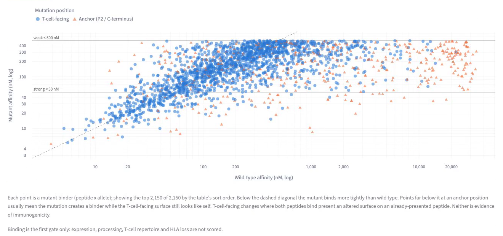

# GDC Mutant Peptide Explorer

**Open NCI cancer mutation data → mutant peptides → predicted HLA class I binding.**

A local Streamlit web app. You type a disease (for example "melanoma"); the app finds the
matching projects on the NCI Genomic Data Commons (GDC), downloads their open-access somatic
mutation (MAF) files, rebuilds the mutant peptides around each missense mutation together with
the matching wild-type peptides, and predicts HLA class I binding for both with MHCflurry.
Results are shown as charts and a ranked table you can download as CSV, with a provenance file.

**Research use only.** Predicted MHC binding is only the first gate. It is not
immunogenicity, and nothing here supports clinical decisions.



*Each point is a mutant peptide predicted to bind an HLA allele (under 500 nM), plotted against
its wild-type counterpart. Triangles mark mutations at an anchor position. 50 open-access
TCGA-PAAD files, 9-mers, demo allele panel.*

What it does well:

- **Checks before it predicts.** `HGVSp_Short`, `Protein_position` and `Amino_acids` are
  cross-checked, and the reference amino acid is confirmed in the fetched protein before any
  peptide is built. Every skipped row is counted with a reason.
- **Mutant and wild-type side by side**, scored in the same model call.
- **A funnel** showing where mutations drop out, from MAF rows to predicted binders.
- **Provenance on every export:** GDC file IDs and md5, data release, genome build, Ensembl
  release, predictor version and all parameters.
- **Open data only.** No GDC account or token is needed.

## What you need

- macOS, Linux or Windows.
- **Python 3.11** (3.10-3.12 should work; 3.11 is what it was tested with).
  On macOS the built-in `python3` is often 3.9, which is too old. Install 3.11 from
  https://www.python.org/downloads/ or with Homebrew: `brew install python@3.11`.
- About **2.5 GB of free disk space**: ~1.1 GB for the Python packages (PyTorch is most of it)
  and ~0.4 GB for the MHCflurry models, plus room for the download cache.
- An internet connection. The app calls the GDC API (api.gdc.cancer.gov) and the Ensembl REST
  API (rest.ensembl.org). No account or token is needed; only open-access data is used.

## Quick start (macOS / Linux)

```bash
git clone https://github.com/btarun13/gdc-mutant-peptide-explorer.git
cd gdc-mutant-peptide-explorer
./start.sh
```

The first run creates a virtual environment in `.venv`, installs the packages, downloads the
MHCflurry models (one-time, a few hundred MB), and opens the app at http://localhost:8501.
Later runs skip straight to starting the app. Stop the app with `Ctrl+C`.

If your Python 3.11 is not called `python3.11`, tell the script which one to use:

```bash
PYTHON=/path/to/python3.11 ./start.sh
```

## Manual setup (any OS, including Windows)

```bash
# 1. Get the code and create a virtual environment
git clone https://github.com/btarun13/gdc-mutant-peptide-explorer.git
cd gdc-mutant-peptide-explorer
python3.11 -m venv .venv
source .venv/bin/activate            # Windows (PowerShell): .venv\Scripts\Activate.ps1
                                     # Windows (cmd):        .venv\Scripts\activate.bat

# 2. Install the packages
python -m pip install --upgrade pip
python -m pip install -r requirements.txt

# 3. Download the MHCflurry models (one-time)
mhcflurry-downloads fetch

# 4. Start the app
streamlit run app.py
```

Then open http://localhost:8501 in a browser if it does not open by itself.

## Using the app

1. **Disease**: type a disease, site or project, e.g. `melanoma`, `lung adenocarcinoma`,
   `TCGA-PAAD`. Pick the project(s) to use; a TCGA project is pre-selected when one matches.
2. **Open-access MAF files**: choose the variant-calling workflow (the TCGA default is
   pre-selected) and how many MAF files to use. Each file is one tumour sample.
3. **Peptides and HLA alleles**: choose peptide lengths (9 by default; 8-11 allowed) and the HLA
   class I alleles. The pre-filled alleles are a demo panel of common alleles, **not a patient's
   HLA type**; MAF files contain no HLA typing. Click **Run**.
4. **Results**:
   - **Funnel**: how many mutations survive each step (missense filter, protein found,
     reference-residue check) and how many peptides and binders result.
   - **Mutant vs wild type**: mutant against wild-type binding for every predicted binder,
     coloured by whether the mutation sits at an anchor position or a T-cell-facing position.
   - **Recurrence**: variants carried by two or more of the loaded patients that give a binder.
   - **Table**: the ranked table, with CSV download.
   - **Quality checks** and **Provenance**: reference mismatch rate, GDC file IDs, data
     release, predictor version and all parameters. Download the provenance JSON with any CSV
     you keep.

### Tips

- **Start small**: 3-5 MAF files and peptide length 9. The app refuses jobs above 200,000
  peptide x allele predictions (`MAX_CLASS1_JOB` in `src/config.py`) and shows a red error
  instead of results. High-mutation cancers (melanoma, lung) reach that limit with only a few
  files; use fewer files or fewer alleles, or raise the limit in `src/config.py`.
- **The first run is slow**, mostly while fetching protein sequences from Ensembl. Everything
  (MAF files, proteins, predictions) is cached in `data/cache/`, so repeat runs are fast.
  Delete that folder to clear the cache.
- **Recurrence** needs many patients to show anything; with a handful of files most variants
  are seen in only one patient.

## Running the tests

```bash
source .venv/bin/activate
pytest -q -m "not network and not models"   # fast, offline
pytest -q -m network                        # live GDC / Ensembl / UniProt calls
pytest -q -m models                         # real MHCflurry predictions (needs the models)
```

## Known limitations

- Missense mutations only (no indels or frameshifts yet), MHC class I only.
- Open-access GDC MAFs are germline-masked with deliberately aggressive criteria, so some real
  somatic mutations are missing. Normal-sample read counts are blanked in open MAFs.
- Protein sequences come from the current Ensembl release, while the GDC annotation follows
  GENCODE v36, so a small fraction of mutations fail the reference-residue check; the rate is
  shown in Quality checks.
- When Ensembl does not know any protein in a request it answers "404 Not Found"; the app
  currently logs this as a failed Ensembl batch and may show a warning that Ensembl failed for
  some proteins even though the service is up. Those proteins are simply not available in the
  current Ensembl release.
- Results stay on screen until the next successful run. If a run stops with an error (for
  example the job-size limit), the charts below may still be from the previous run.

## Project layout

```
app.py                  Streamlit UI (wiring only)
src/config.py           all settings: thresholds, lengths, default alleles, limits
src/pipeline.py         the pipeline stages and funnel counts
src/gdc/                GDC API: project search, MAF file listing and download
src/maf/                MAF parsing and missense extraction
src/protein/source.py   Ensembl protein sequences, cached on disk
src/peptides/           mutant / wild-type peptide windows
src/predict/            MHCflurry backend and prediction cache
src/rank/score.py       flags and sorting
src/viz/charts.py       charts
tests/                  tests and small fixtures
docs/                   images used in this README
CLAUDE.md, SKILL.md     developer notes and design rules
```

## Contributing

Issues and pull requests are welcome. See [CONTRIBUTING.md](CONTRIBUTING.md) for setup, tests
and the project's scope rules. CI runs `ruff check .` and the offline tests on Python
3.10-3.12.

## Licence

[MIT](LICENSE). The data and tools this app uses have their own terms: GDC open-access data
follows the [GDC data use policies](https://gdc.cancer.gov/access-data/data-access-processes-and-tools),
and MHCflurry is Apache-2.0.

## Acknowledgements and citation

If you use this tool in your work, please also cite the resources it depends on:

- **TCGA / GDC data:** "The results shown here are in whole or part based upon data generated
  by the TCGA Research Network: https://www.cancer.gov/tcga." Grossman RL et al. *Toward a
  shared vision for cancer genomic data.* N Engl J Med 2016.
- **MHCflurry:** O'Donnell TJ, Rubinsteyn A, Laserson U. *MHCflurry 2.0: Improved pan-allele
  prediction of MHC class I-presented peptides by incorporating antigen processing.*
  Cell Systems 2020.
- **Ensembl REST API:** Yates A et al. *The Ensembl REST API: Ensembl data for any language.*
  Bioinformatics 2015.

The test fixture `tests/fixtures/skcm_slice.maf.gz` is a small slice of an open-access TCGA-SKCM
MAF from the GDC.
